<!-- Styled after ianne-portfolio.vercel.app: an editor on the left, the rendered page on the right. -->

<p align="center">
  <a href="https://ianne-portfolio.vercel.app/">
    
  </a>
</p>

<p align="center">
  <a href="https://ianne-portfolio.vercel.app/"></a>
  <a href="https://www.linkedin.com/in/ianne-carl-bulilan-321421349/"></a>
  <a href="https://t.me/IanneTG"></a>
  <a href="https://cal.com/ianne-carl-bulilan-gladiarn"></a>
  <a href="mailto:bulilaniannecarl@gmail.com"></a>
</p>

<br/>

<sub><code>● about.md</code></sub>

## About

I build full-stack web apps with **Next.js**, **Node.js (Express)**, and **PostgreSQL**. At **KPVE** (Jun to Nov 2026) I built **DOC On Call**, an Australian telehealth platform with **Stripe** payments, **Zoom** consults, and **Medicare/PRODA** claims, plus the **SALT Hotel CRM** and an offline-first **restaurant POS**.

Before that I shipped **15+ web apps** as an independent contractor, from **Figma** to **Vercel**: stores with Stripe checkout, QR restaurant ordering, inventory, booking with live GPS, and AI tools.

My workflow runs on **Claude Code**:

```sh
➜ workflow --steps
brainstorm → plan → confirm → build test-first → verify
```

Right now I'm learning **Docker**, **automation** (n8n), and **Android** development.

<br/>

<sub><code>● projects/</code></sub>

## Projects

| Project | What it is | Built with | Links |
| --- | --- | --- | --- |
| **Scentique** | Perfume store with a "find your scent" quiz, Stripe checkout, and an admin CRM for revenue, orders and low stock. Turborepo monorepo with Zod schemas shared between frontend and API. | `Next.js` `Express` `Prisma` `PostgreSQL` `Stripe` `Vitest` `Playwright` | [Code](https://github.com/Gladiarn/Scentique-Monorepo) |
| **Kasumi-an** | English/Japanese brand site with hand-built canvas animations, ink-cloud page transitions, a waitlist, and a private admin studio. Express API with Helmet, Zod and pino, 670+ tests. | `Next.js` `Express` `Zod` `Vitest` `Supertest` `Vercel Services` | [Live](https://kasumi-an.cc.cd) |
| **BriefCV** | AI resume builder that rewrites and scores resumes against ATS filters with the Gemini API. Drag-and-drop editor, score charts, and pixel-accurate PDF export. | `Next.js` `Gemini API` `Puppeteer` `Recharts` `Google OAuth` `JWT` | [Live](https://briefcv.vercel.app/) · [Code](https://github.com/Gladiarn/briefcv) |
| **Theebug** | VS Code-styled game where players drag and drop to fix broken code across 7 languages, coached by a 3D mascot, with a GitHub sign-in leaderboard. | `React DnD` `React Three Fiber` `Auth.js` `MongoDB` | [Live](https://www.theebug.cc.cd) · [Code](https://github.com/Gladiarn/Theebug) |

More, with screenshots and videos: **[ianne-portfolio.vercel.app/work](https://ianne-portfolio.vercel.app/work)**

<br/>

<sub><code>● experience.log</code></sub>

## Experience

**Full-Stack Web Developer**, KPVE · Remote · <sub>`Jun 2026 - Nov 2026`</sub>
- **DOC On Call:** Australian telehealth platform (**Laravel**, **Next.js**, **MySQL**) with **Stripe** payments, **Zoom** video consults, **Medicare/PRODA** claims, and a 4-portal clinical CRM with real-time chat via **WebSockets** (Laravel Reverb).
- **SALT Hotel CRM:** management system for a three-hotel group covering front desk, housekeeping, finance, and stock (**Next.js**, **Express**, **Prisma**, **PostgreSQL**, on **Vercel** + **Railway**).
- **Restaurant POS:** tablet POS and menu system for Hikka Regent (**Next.js**) that **works offline** (Service Workers, IndexedDB) and syncs when back online.
- **Hotel websites:** Hikka Regent site with a direct booking flow (**Next.js** + **Supabase**), plus other client landing pages.

**Full-Stack Developer (Independent Contractor)**, Self-Employed (client work under NDA) · Remote · <sub>`Mar 2025 - May 2026`</sub>
- Built **15+ web apps** from **Figma** to **Vercel**: e-commerce, restaurant ordering, inventory, booking, and AI tools.
- **E-commerce and CRMs:** stores with **Stripe** checkout and admin dashboards for orders and stock (**Next.js**, **Express**, **Prisma**, **PostgreSQL**).
- **Business systems:** QR restaurant ordering with a kitchen display, multi-warehouse inventory (**Express**, **Prisma**, **Supabase**; **Django**, **Chart.js**), and booking apps with **live GPS tracking** (React, Express, MongoDB, Leaflet).
- **AI tools:** AI resume writer with the **Gemini API**, **MongoDB**, and **PDF export** (Puppeteer).

**Frontend Developer (Intern)**, Symphonics Co. Ltd. · Tacloban City · <sub>`Feb 2025 - May 2025`</sub>
- Turned **Figma** designs into responsive **Next.js** pages with **Tailwind CSS**, **shadcn/ui**, and **TypeScript**.
- Connected **REST APIs**, used **Server Components** to speed up pages, and worked in **Agile (Scrum)** with code reviews on every PR.

<br/>

<sub><code>● package.json</code></sub>

## Tech stack

**Frontend**
<br/>

<br/>
<sub>shadcn/ui · Material UI · Zustand · Redux · React Hook Form · Zod · Framer Motion · PWA (offline-first)</sub>

**Backend and APIs**
<br/>

<br/>
<sub>REST APIs · WebSockets (Laravel Reverb) · Authentication (JWT, OAuth, NextAuth) · Role-based access control</sub>

**Databases**
<br/>

<br/>
<sub>Neon · Mongoose</sub>

**Integrations and AI**
<br/>
<sub>Stripe · Zoom · Twilio · SendGrid · Xero · Medicare/PRODA APIs · Google Gemini API · Claude Code</sub>

**Testing and DevOps**
<br/>

<br/>
<sub>Playwright · PHPUnit · Sentry · Railway · Agile (Scrum)</sub>

<br/>

<sub><code>● education.md</code></sub>

## Education

**BS Information Technology**, AMA Computer Learning Center · Tacloban City, Leyte · <sub>`2023 - Jul 2025`</sub>
- Best in **HTML5 & CSS** and Best in **Web Development**
- Best Capstone Presenter: *Cloud-based Van Travel and Tours Tracking and Monitoring System of Grand Tours Tacloban City*

**BS Information Technology**, University of Rizal System Binangonan · Binangonan, Rizal · <sub>`Aug 2020 - Dec 2022`</sub>
- Dean's Lister (first year)

<br/>

<sub><code>● github.com/Gladiarn</code></sub>

## GitHub activity

<p align="center">
  
</p>

<br/>

<sub><code>● contact.ts</code></sub>

## Contact

Open to **full-stack roles**, freelance projects and collaborations. The quickest way to reach me is email or Telegram.

| | |
| --- | --- |
| Email | [bulilaniannecarl@gmail.com](mailto:bulilaniannecarl@gmail.com) |
| Telegram | [@IanneTG](https://t.me/IanneTG) |
| LinkedIn | [ianne-carl-bulilan](https://www.linkedin.com/in/ianne-carl-bulilan-321421349/) |
| Schedule a call | [cal.com/ianne-carl-bulilan-gladiarn](https://cal.com/ianne-carl-bulilan-gladiarn) |
| Portfolio | [ianne-portfolio.vercel.app](https://ianne-portfolio.vercel.app/) |

<br/>

<p align="center">
  <a href="https://ianne-portfolio.vercel.app/"></a>
</p>
