<!--
  Every image here is captured from ianne-portfolio.vercel.app by scripts/capture.mjs,
  in the site's dark and light themes. Re-run `npm run capture` after the site changes.
-->

<a href="https://ianne-portfolio.vercel.app/">
  <picture>
    <source media="(prefers-color-scheme: dark)" srcset="./asset/hero-dark.png" />
    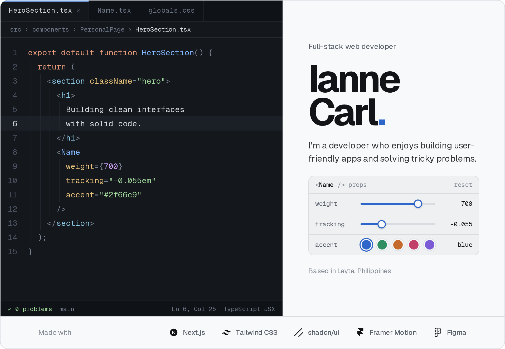
  </picture>
</a>

  <a href="https://t.me/IanneTG"><picture><source media="(prefers-color-scheme: dark)" srcset="./asset/btn-dm-dark.png" /></picture></a>
  <a href="https://cal.com/ianne-carl-bulilan-gladiarn"><picture><source media="(prefers-color-scheme: dark)" srcset="./asset/btn-call-dark.png" /></picture></a>
  <a href="mailto:bulilaniannecarl@gmail.com"><picture><source media="(prefers-color-scheme: dark)" srcset="./asset/btn-email-dark.png" /></picture></a>
  <a href="https://www.linkedin.com/in/ianne-carl-bulilan-321421349/"><picture><source media="(prefers-color-scheme: dark)" srcset="./asset/btn-linkedin-dark.png" /></picture></a>
  <a href="https://ianne-portfolio.vercel.app/"><picture><source media="(prefers-color-scheme: dark)" srcset="./asset/btn-portfolio-dark.png" /></picture></a>

 

<picture>
  <source media="(prefers-color-scheme: dark)" srcset="./asset/about-dark.png" />
  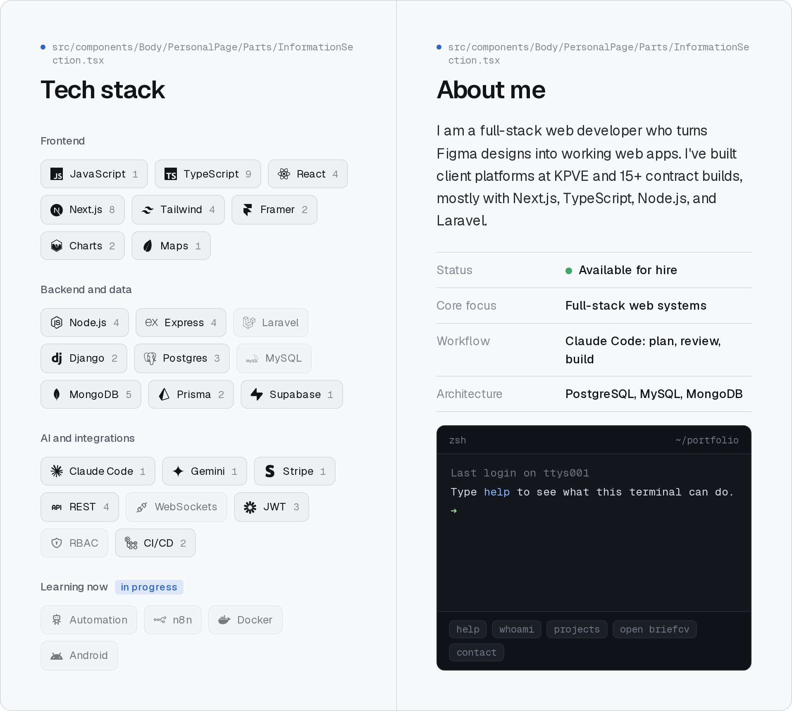
</picture>

The number on each tool is how many of my projects use it.

  

<picture>
  <source media="(prefers-color-scheme: dark)" srcset="./asset/h-projects-dark.png" />
  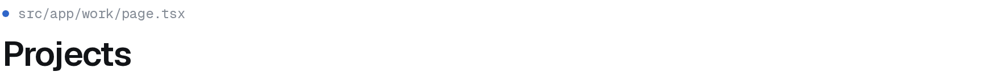
</picture>

  <a href="https://github.com/Gladiarn/Scentique-Monorepo"><picture><source media="(prefers-color-scheme: dark)" srcset="./asset/p-scentique-dark.png" />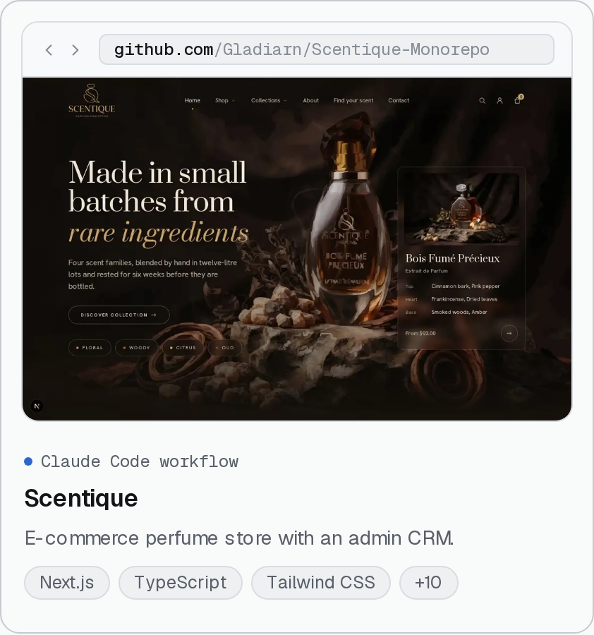</picture></a>
  <a href="https://kasumi-an.cc.cd"><picture><source media="(prefers-color-scheme: dark)" srcset="./asset/p-kasumi-an-dark.png" />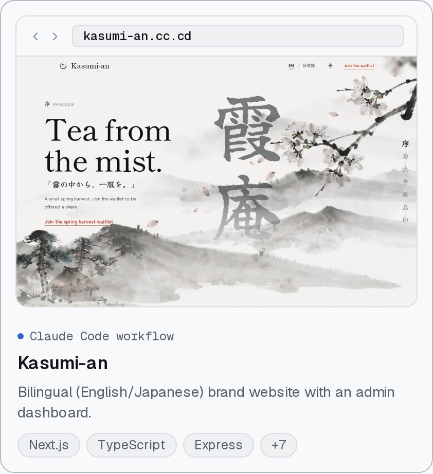</picture></a>

  <a href="https://briefcv.vercel.app/"><picture><source media="(prefers-color-scheme: dark)" srcset="./asset/p-briefcv-dark.png" />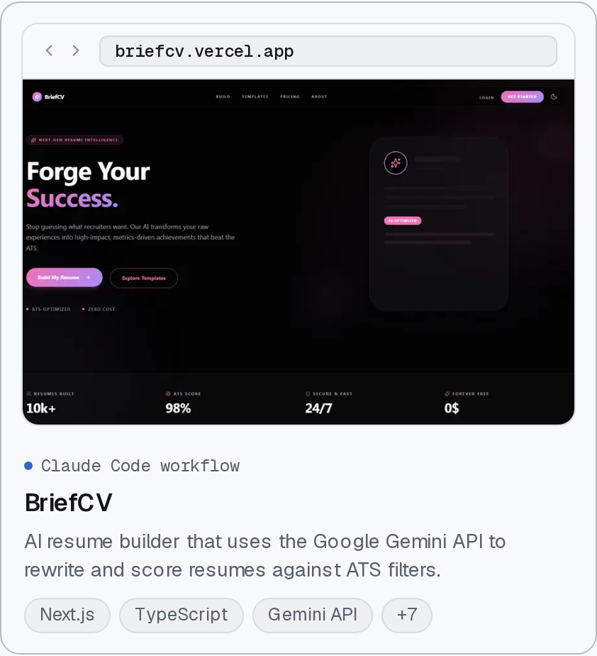</picture></a>
  <a href="https://www.theebug.cc.cd"><picture><source media="(prefers-color-scheme: dark)" srcset="./asset/p-theebug-dark.png" />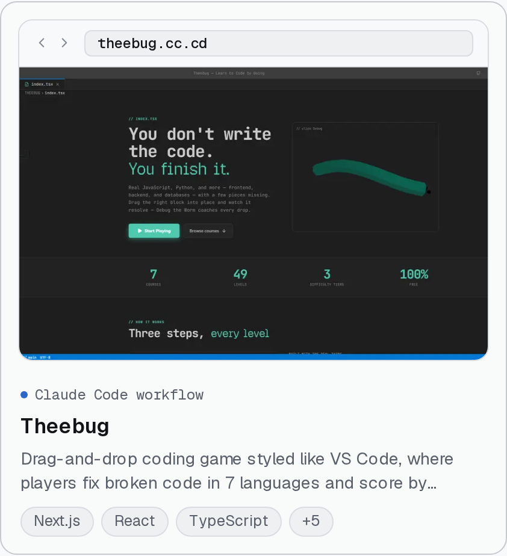</picture></a>

13 projects with screenshots and videos at <a href="https://ianne-portfolio.vercel.app/work">ianne-portfolio.vercel.app/work</a>

  

<picture>
  <source media="(prefers-color-scheme: dark)" srcset="./asset/h-experience-dark.png" />
  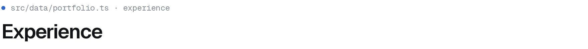
</picture>

**Full-Stack Web Developer** · KPVE · Remote · <code>Jun 2026 - Nov 2026</code>

- **DOC On Call:** Australian telehealth platform (Laravel, Next.js, MySQL) with Stripe payments, Zoom video consults, Medicare/PRODA claims, and a 4-portal clinical CRM with real-time chat over WebSockets (Laravel Reverb).
- **SALT Hotel CRM:** management system for a three-hotel group covering front desk, housekeeping, finance and stock (Next.js, Express, Prisma, PostgreSQL, on Vercel + Railway).
- **Restaurant POS:** tablet POS and menu system for Hikka Regent (Next.js) that works offline (Service Workers, IndexedDB) and syncs when back online.
- **Hotel websites:** Hikka Regent site with a direct booking flow (Next.js + Supabase), plus other client landing pages.

**Full-Stack Developer (Independent Contractor)** · Self-employed, client work under NDA · Remote · <code>Mar 2025 - May 2026</code>

- Built 15+ web apps from Figma to Vercel: e-commerce, restaurant ordering, inventory, booking and AI tools.
- **E-commerce and CRMs:** stores with Stripe checkout and admin dashboards for orders and stock (Next.js, Express, Prisma, PostgreSQL).
- **Business systems:** QR restaurant ordering with a kitchen display, multi-warehouse inventory (Express, Prisma, Supabase; Django, Chart.js), and booking apps with live GPS tracking (React, Express, MongoDB, Leaflet).
- **AI tools:** AI resume writer with the Gemini API, MongoDB and PDF export (Puppeteer).

**Frontend Developer (Intern)** · Symphonics Co. Ltd. · Tacloban City · <code>Feb 2025 - May 2025</code>

- Turned Figma designs into responsive Next.js pages with Tailwind CSS, shadcn/ui and TypeScript.
- Connected REST APIs, used Server Components to speed up pages, and worked in Agile (Scrum) with code reviews on every PR.

 

<picture>
  <source media="(prefers-color-scheme: dark)" srcset="./asset/h-education-dark.png" />
  
</picture>

**BS Information Technology** · AMA Computer Learning Center · Tacloban City, Leyte · <code>2023 - Jul 2025</code>

- Best in HTML5 & CSS and Best in Web Development
- Best Capstone Presenter: *Cloud-based Van Travel and Tours Tracking and Monitoring System of Grand Tours Tacloban City*

**BS Information Technology** · University of Rizal System Binangonan · Binangonan, Rizal · <code>Aug 2020 - Dec 2022</code>

- Dean's Lister (first year)

 

<picture>
  <source media="(prefers-color-scheme: dark)" srcset="./asset/activity-dark.png" />
  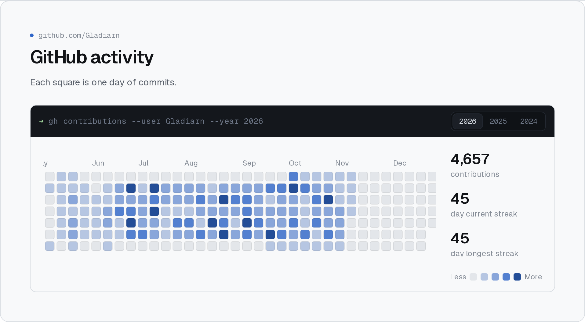
</picture>

  

<a href="https://ianne-portfolio.vercel.app/">
  <picture>
    <source media="(prefers-color-scheme: dark)" srcset="./asset/contact-dark.png" />
    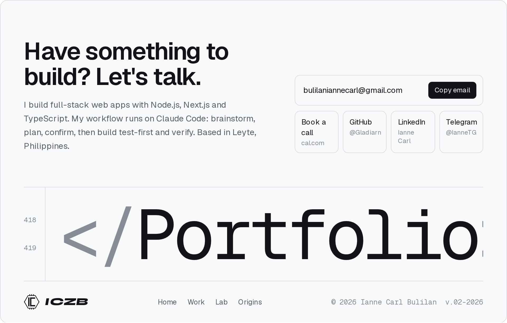
  </picture>
</a>

  <a href="mailto:bulilaniannecarl@gmail.com">bulilaniannecarl@gmail.com</a> ·
  <a href="https://cal.com/ianne-carl-bulilan-gladiarn">Book a call</a> ·
  <a href="https://t.me/IanneTG">Telegram</a> ·
  <a href="https://www.linkedin.com/in/ianne-carl-bulilan-321421349/">LinkedIn</a>

<picture>
  <source media="(prefers-color-scheme: dark)" srcset="./asset/statusbar-dark.png" />
  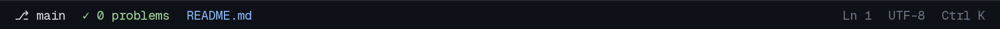
</picture>
